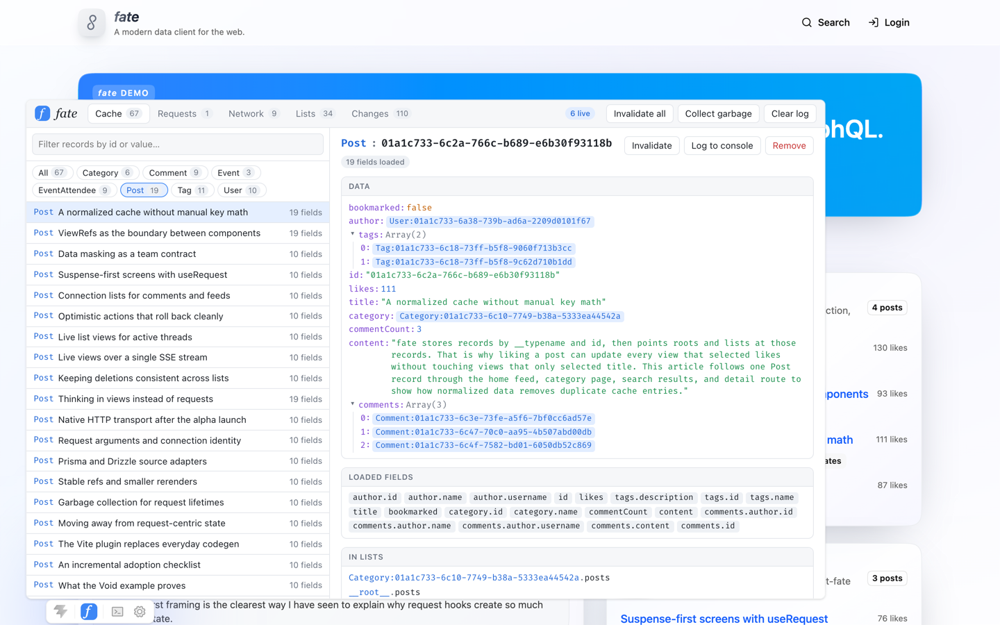
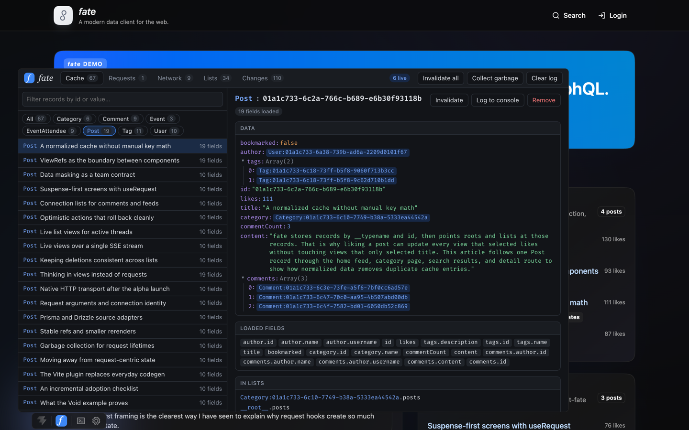

# Devtools

_fate_ comes with devtools that show what your client is doing while you build your app. They work like TanStack Query's devtools and run as a panel in [Vite DevTools](https://devtools.vite.dev/), next to the other tools for your app.

<p align="center">
  
  
</p>

The panel shows:

- **Cache:** every normalized record, grouped by type. For each record you can see the fields fate has loaded, which fields are stale, which lists contain it, and which records refer to it. Click a reference to jump to that record.
- **Requests:** the requests your screens keep alive, their roots and arguments, the fields they select, and how many components are observing them.
- **Network:** every call fate makes through its transport (`byId`, `list`, `query`, mutations, and live subscriptions), with timing, selections, arguments, and responses or errors.
- **Lists:** connection and list state, including items, cursors, and pagination.
- **Changes:** a log of cache writes, including invalidations and optimistic updates.

From the panel you can invalidate or remove a record, log a record to the browser console (as `$fate`), and run garbage collection.

## Installation

Install the devtools and Vite DevTools as development dependencies of your client:

::: code-group

```bash [npm]
npm add -D @nkzw/fate-devtools @vitejs/devtools
```

```bash [pnpm]
pnpm add -D @nkzw/fate-devtools @vitejs/devtools
```

```bash [yarn]
yarn add -D @nkzw/fate-devtools @vitejs/devtools
```

:::

## Vite Plugin

Enable Vite DevTools and add the devtools plugin to your Vite config:

```ts
import { fateDevtools } from '@nkzw/fate-devtools/vite';
import { fate } from 'react-fate/vite';
import { defineConfig } from 'vite';

export default defineConfig({
  devtools: true,
  plugins: [
    fate({
      module: '@your-org/server/trpc/router.ts',
    }),
    fateDevtools(),
  ],
});
```

The plugin only runs during development. It adds a _fate_ entry to the Vite DevTools dock and serves the panel at `/__fate-devtools/`. You can also open that URL in its own tab, which is handy when you don't use Vite DevTools or want the panel on a second screen.

## Connecting a Client

With React, render `<FateDevtools />` inside your `<FateClient>`. It connects the client from context and renders nothing:

```tsx
import { FateDevtools } from '@nkzw/fate-devtools/react';
import { FateClient } from 'react-fate';

export function App() {
  return (
    <FateClient client={fate}>
      {import.meta.env.DEV && <FateDevtools />}
      <Root />
    </FateClient>
  );
}
```

For Vue or other setups, call `connectFateDevtools` with your client. It returns a function that disconnects the client again:

```ts
import { connectFateDevtools } from '@nkzw/fate-devtools';

if (import.meta.env.DEV) {
  connectFateDevtools(fate);
}
```

Guard the devtools with `import.meta.env.DEV` so they are not included in production builds. If your app creates more than one client, pass a `name` to tell them apart in the panel:

```tsx
<FateDevtools name="admin" />
```

## Server-Rendered Apps

Vite DevTools adds its dock to pages through Vite's HTML transform. Frameworks that render HTML on the server, such as [Void](/integrations/void), don't run that transform, so load the dock yourself in development:

```ts
if (import.meta.env.DEV && typeof document !== 'undefined') {
  const script = document.createElement('script');
  script.type = 'module';
  script.src = '/__devtools/embedded.js';
  document.head.append(script);
}
```

The first time you open Vite DevTools in a browser, it asks you to authorize that browser with a code printed in your terminal.

## How It Works

The devtools don't change how _fate_ behaves. When you connect a client, the devtools wrap its transport to record network activity and listen to cache changes. The page then sends snapshots to the panel over a [`BroadcastChannel`](https://developer.mozilla.org/en-US/docs/Web/API/BroadcastChannel). Snapshots are only sent while a panel is open. When you disconnect, the client's original transport is restored.

Because the panel and your app talk over a `BroadcastChannel`, the panel works anywhere on the same origin: in the Vite DevTools dock, in a separate tab, or in a popup. When more than one page or client is connected, use the picker in the panel's toolbar to switch between them.
